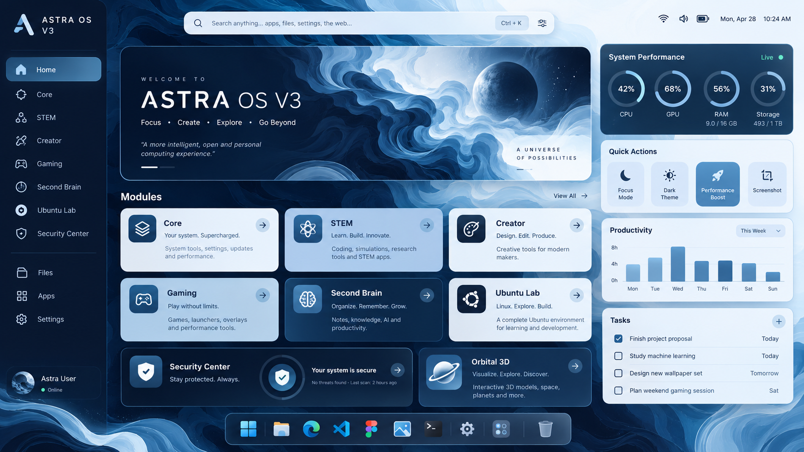

# Confronto visivo — 28 ottobre 2026

## Riferimento approvato

La risorsa presente nel repository è `docs/V4-REFERENCE-UI.png`. La grafica originale riporta il marchio V3; l'implementazione mantiene la struttura e usa il marchio V4 richiesto.

## Applicazione WinUI reale

Screenshot acquisito dalla finestra Windows, non dal design preview. Il profilo è separato e contrassegnato QA; le attività visibili sono dati di test espliciti, le metriche sono letture effettive della macchina. La barra della produttività deriva dalle attività completate di quel profilo.

## Corrispondenze e differenze

La gerarchia comprende sidebar, ricerca, hero con artwork, griglia Core/STEM/Creator/Gaming/Second Brain/Ubuntu, Security e Orbital, colonna dei widget e dock. Sono mantenuti i cinque colori Cosmic Navy, Ice, Blue, Deep e Snow. Le card chiare conservano testo scuro anche durante hover e focus.

La replica **non è pixel-identica**: icone Segoe al posto delle illustrazioni del mockup, barre CPU/RAM al posto dei quattro indicatori circolari decorativi, tre azioni rapide, sidebar con moduli aggiuntivi e dock di navigazione ASTRA. Il grafico usa attività completate reali e non riproduce i valori illustrativi del riferimento. Lo sfondo è più scuro per il contrasto del testo.

Il layout corregge il precedente taglio orizzontale dei widget. Sotto 1120 unità logiche i widget passano sotto la griglia principale; il dock ha scorrimento orizzontale. È stata verificata la finestra a scala reale 100%. Le prove del sistema a 150% e 200% sono **NOT TESTED**: la scala Windows non è stata modificata durante questa sessione.

## Orbital in esecuzione

La scena è illustrativa; non rappresenta telemetria acquisita né una simulazione fisica validata. Due cicli successivi di caricamento e rilascio sono controllati dalla suite UI nel rapporto finale.
