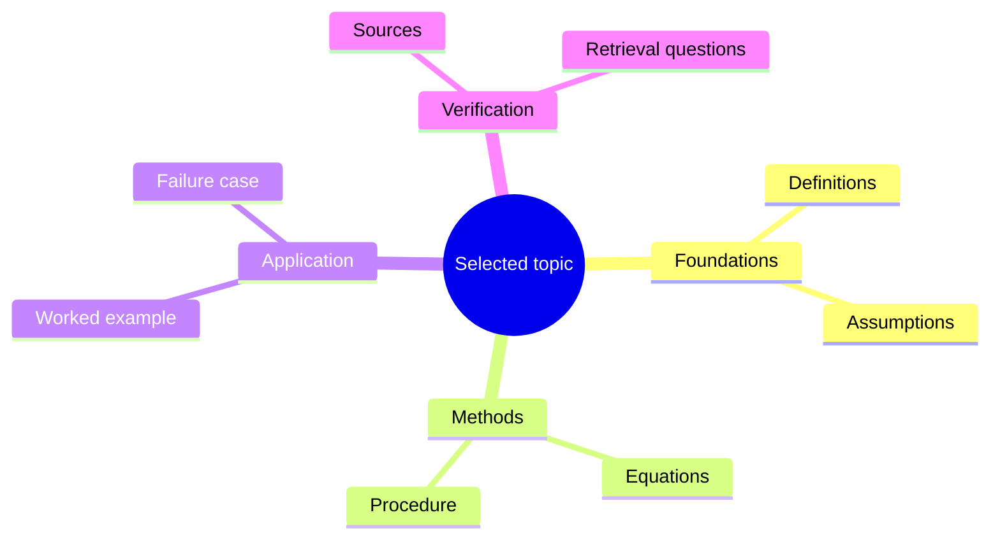

# {{title}}

## Central question

## Concepts and links

| Concept / source note | Definition | Relationship and direction | Prerequisite | Example / misconception |
| --- | --- | --- | --- | --- |
|  |  | causes / depends-on / generalizes / contrasts |  |  |

## Visual map

Replace this structure with concepts from the selected source notes. Use Canvas for free placement or edit the Mermaid map below.

## Review prompts

- Explain the direction of each relationship without reading the note.
- Give a counterexample to a misleading analogy.
- Identify one missing prerequisite.

Related: [[Astra Command Center/08 Study Lab|Study Lab]] · [[Astra Command Center/19 Connections and Idea Transfer|Connections and Idea Transfer]] · [[Astra Command Center/07 Evidence Ledger|Evidence Ledger]]
